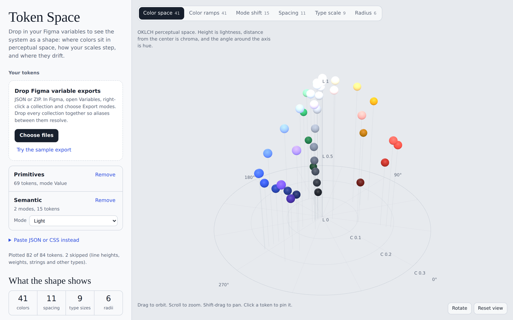
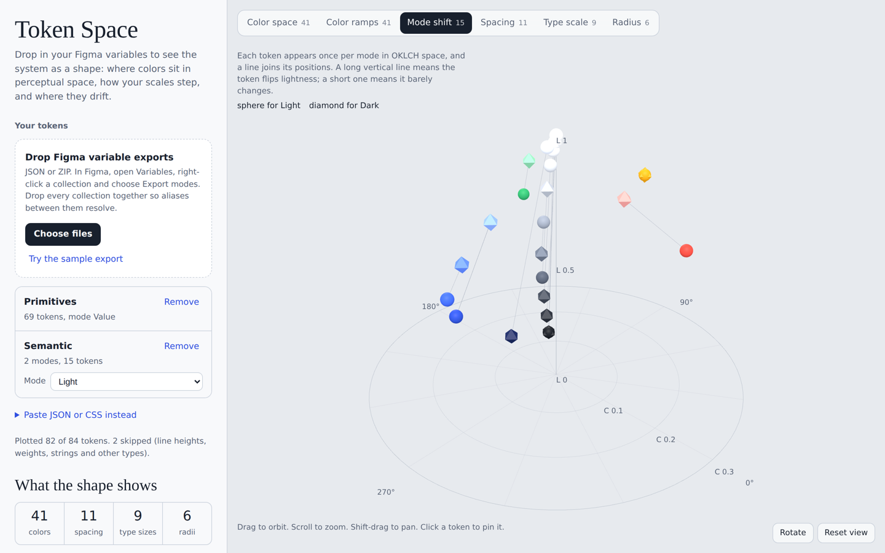

# Token Space

See your design system as a shape.

Token Space reads your design tokens, including Figma's native variable exports, and renders them in 3D. Colors are placed in OKLCH perceptual space, so you can see where your palette clusters and where it has gaps. Ramps become lightness slopes, light and dark modes become visible movement, and spacing, type and radius each get their own view.

**[Open Token Space →](https://raghurai.github.io/Tokenspace/)**



## Why

Design systems usually live in swatch grids and token tables. Those are good for looking up a value and bad at showing how the values relate. Token Space is built for audits and for conversations with engineering, so the shape of the system is something you can point at.

It also flags problems for you:

- Near-duplicate colors (ΔE in OKLab under 0.015)
- Color ramps whose lightness steps out of order
- Spacing values off the 4px grid, and spacing tokens that share a value
- Type scales that drift from a consistent ratio, with the closest named interval
- Semantic tokens that keep the same value in every mode

## Views

| View | What it shows |
| --- | --- |
| Color space | Every unique color in OKLCH. Height is lightness, distance from the axis is chroma, angle is hue. |
| Color ramps | One row per color family, one tower per step. Tower height is perceptual lightness. |
| Mode shift | Each token in a multi-mode collection plotted once per mode, joined by a line. |
| Spacing | Spacing and size tokens as bars, with off-grid values highlighted. |
| Type scale | Font sizes stacked into a pyramid; the outline is the curve of your scale. |
| Radius | Each corner radius drawn on a real tile. |



## Bring your own Figma variables

1. In Figma, open the **Variables** view.
2. Right-click a collection and choose **Export modes**. Do this for every collection, including primitives, so aliases between collections resolve.
3. Open Token Space and drop all the exported files onto the page (JSON or ZIP).

Each collection appears in the side panel. Collections with several modes get a mode picker, and the Mode shift view compares them.

Nothing is uploaded. Files are read in your browser, and the last set you loaded is kept in your browser's local storage so it's there next time.

### Other formats

You can also drop or paste:

- W3C Design Tokens (DTCG) JSON, including the 2025 color and dimension objects
- Style Dictionary and Tokens Studio JSON
- Flat JSON like `{ "color.blue.500": "#3D63E6" }`
- CSS custom properties like `--color-blue-500: #3D63E6;`

Aliases such as `{color.blue.500}` and `var(--color-blue-500)` are resolved. For Figma number variables, scopes decide the category (corner radius, gap, font size), and names are used as a fallback.

## Try it with sample files

The [`samples`](samples) folder contains a three-file Figma-style export: a Primitives collection and a Semantic collection with Light and Dark modes. It includes a few deliberate problems so you can see the checks work. You can also click **Try the sample export** in the app.

## Run it locally

Token Space is a single HTML file with no build step.

```sh
git clone https://github.com/raghurai/Tokenspace.git
cd Tokenspace
python3 -m http.server 8000
```

Then open http://localhost:8000. Opening `index.html` directly from disk also works in most browsers.

It loads [three.js](https://threejs.org) r128 and [JSZip](https://stuk.github.io/jszip/) 3.10.1 from cdnjs, and the Instrument Sans and Instrument Serif fonts from Google Fonts.

## Controls

- Drag to orbit, scroll or pinch to zoom, shift-drag or right-drag to pan
- Hover a token for details, click to pin them
- With the canvas focused: arrow keys orbit, `+` and `-` zoom, `Esc` closes the pinned tooltip

## Roadmap

- A companion Figma plugin that exports every collection and mode in one file
- Optional live sync through the Figma Variables REST API for Enterprise plans
- Contrast pairing between text and surface tokens across modes

Ideas and issues are welcome.

## License

[MIT](LICENSE) © 2026 Raghurai Kulkarni
